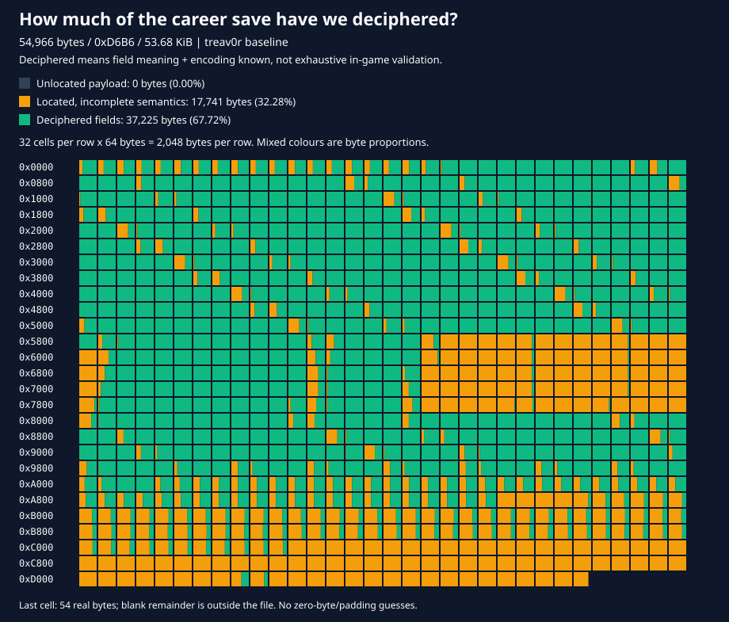

# NFSU2 Savegame Editor — Matavanary Edition

[ **🇹🇭 ภาษาไทย** ] | [ **🇬🇧 English (README_EN.md)** ]

---

เว็บแอปพลิเคชันสำหรับแก้ไขไฟล์เซฟโหมด Career ของเกม **Need for Speed: Underground 2** (ไฟล์เซฟเกมจาก `SPEED2.EXE` ขนาด 54,966 ไบต์ รหัส `20CM`) และรองรับการเปิดไฟล์ ZIP สำรองจาก [nfsu2-web](https://github.com/th0mk/nfsu2-web) รวมถึงโรงรถ 10 สล็อตจากไฟล์ `GARAGE.DAT` ทุกขั้นตอนทำงานในเครื่องของคุณผ่านเว็บเบราว์เซอร์ 100% ไม่มีการอัปโหลดไฟล์ออกนอกเครื่อง

🌐 **เข้าใช้งานออนไลน์ผ่าน GitHub Pages:** [https://matavanary.github.io/NFSU2-Savegame-Editor/](https://matavanary.github.io/NFSU2-Savegame-Editor/)  
📖 รายละเอียดโครงสร้างไบนารีของไฟล์เซฟสามารถอ่านเพิ่มเติมได้ที่ [doc.md](doc.md)

---

## แผนผังโครงสร้างของไฟล์เซฟ (Savefile Discovery Map)



ไฟล์เซฟ Career อ้างอิงมีขนาด **54,966 ไบต์ (`0xD6B6`, 53.68 KiB)** ตารางด้านบนอ่านจากซ้ายไปขวา บนลงล่าง แต่ละช่องแทนข้อมูลขนาด **64 ไบต์** และแต่ละแถวมีขนาด **2,048 ไบต์**

| สถานะการถอดรหัสข้อมูล | จำนวนไบต์ | อัตราส่วนของไฟล์ |
| --- | ---: | ---: |
| ถอดรหัสสมบูรณ์: ทราบความหมายของฟิลด์และวิธีเข้ารหัสแล้ว | 37,225 | **67.72%** |
| ระบุตำแหน่งได้ในโครงสร้าง แต่ความหมายเชิงลึกยังไม่ครบถ้วน | 17,741 | **32.28%** |
| ข้อมูลที่ยังไม่ถูกจัดเข้าโครงสร้างใดๆ | 0 | **0.00%** |
| **ระบุตำแหน่งได้ทั้งหมดในไฟล์** | **54,966** | **100.00%** |

| โครงสร้างที่ระบุตำแหน่งได้ | ช่วงแอดเดรส (ไม่รวมจุดสิ้นสุด) | ขนาด (ไบต์) | ถอดรหัสแล้ว (ไบต์) |
| --- | --- | ---: | ---: |
| Header | `0x0000`–`0x001C` | 28 | 28 |
| Block A compatibility descriptor | `0x001C`–`0x0024` | 8 | 8 |
| Stock catalogue and active count | `0x0024`–`0x04A8` | 1,156 | 772 |
| Generic configurations 20 ชุด | `0x04A8`–`0x5868` | 21,440 | 20,180 |
| เรคอร์ดรถ Career 5 ช่องแรก | `0x5868`–`0x8022` | 10,170 | 5,115 |
| ตัวนับจำนวน Garage-record | `0x8022`–`0x8026` | 4 | 4 |
| Special configurations 6 ชุด | `0x8026`–`0x995E` | 6,456 | 6,054 |
| ตัวนับจำนวน Special-configuration | `0x995E`–`0x9962` | 4 | 4 |
| Stage records 8 ชุด | `0x9962`–`0xA16A` | 2,056 | 1,800 |
| Career scalars และข้อมูล Event 384 รายการ | `0xA16A`–`0xAE9A` | 3,376 | 1,932 |
| ข้อความกล่องจดหมาย SMS 256 ฉบับ | `0xAE9A`–`0xC2A3` | 5,129 | 1,288 |
| Career tail | `0xC2A3`–`0xC447` | 420 | 0 |
| Profile copy spans | `0xC447`–`0xD225` | 3,550 | 0 |
| ฟิลด์ชื่อคนขับ (Driver Name) | `0xD225`–`0xD245` | 32 | 32 |
| Auxiliary tail object | `0xD245`–`0xD278` | 51 | 8 |
| Runtime-state records 6 รายการ | `0xD278`–`0xD6B6` | 1,086 | 0 |

---

## ฟีเจอร์หลัก (Features)

* **🇹🇭 รองรับ 2 ภาษาเต็มรูปแบบ (Bilingual):** สลับใช้งานระหว่างภาษาไทยและภาษาอังกฤษได้ด้วยคลิกเดียวที่แถบเมนูด้านบน
* **⚡ ปุ่มลัดเงินด่วน (Quick Money Presets):** เพิ่มเงินได้ทันที `+50K`, `+100K`, `+500K`, หรือตั้งค่าเงินสูงสุดของเกม **`Max ($2.1B)`** ($2,147,483,647) รวมถึงรีเซ็ตเป็น `$0`
* **📂 ลากวางไฟล์เซฟ (Drag & Drop):** ลากไฟล์เซฟ (`20CM`) หรือไฟล์ ZIP มาวางลงบนหน้าเว็บเพื่อเปิดใช้งานได้ทันที
* **⏱️ ระบบสำรองประวัติและกู้คืนเซฟ (Snapshot / Backup Manager):** บันทึกประวัติเซฟล่าสุดเก็บไว้ในเบราว์เซอร์อัตโนมัติ (สูงสุด 5 รายการ) สามารถกด **Restore (กู้คืนเซฟนี้)** ได้ทุกเมื่อ
* **📱 ใช้งานออฟไลน์ 100% (PWA Ready):** มี Service Worker แคชไฟล์ทั้งหมดในตัว สามารถกด **"Install App"** ติดตั้งเป็นโปรแกรม Desktop บน Windows ได้โดยไม่ต้องต่ออินเทอร์เน็ต
* **แก้ไขโปรไฟล์ (Profile):** เปลี่ยนชื่อคนขับ (Driver Name) และจำนวนเงิน (Money) พร้อมคำนวณ Checksum ใหม่อัตโนมัติเมื่อดาวน์โหลดเพื่อป้องกันเซฟเสีย
* **ปลดล็อก Career (Career Access):** เลือกระดับ Stage **0–6**, ปลดล็อกร้านค้า (Shop discovery) โดยไม่กระทบเนื้อเรื่องหลัก และมีฟังก์ชัน **Complete career (100%)** เคลียร์ทุกด่านและการถ่ายแบบ
* **จัดการโรงรถ (Garage):** ตรวจสอบ ยี่ห้อ และรุ่นของรถในแต่ละช่อง สลับช่องจอด (Swap slots) ปลดล็อกทุกช่อง หรือเปลี่ยนรถเข้าช่อง (Replace/Add car) โดยค่า Tuning เดิมยังคงอยู่
* **อัปเกรดชิ้นส่วน (Performance Parts):** เลือกปรับแต่งชุดแต่งสมรรถนะ Package 1–3 และชิ้นส่วน Unique Performance แยกตามประเภท
* **ตกแต่งภายนอก (Visuals):** ปรับแต่งบอดี้พาร์ท, สีรถ, ลายไวนิล 4 เลเยอร์พร้อมเลือกสี, สติกเกอร์ Decals, ไฟนีออน, เครื่องเสียงท้ายรถ, และหน้าปัดวัดความเร็ว
* **ระบบ Dyno & จูนนิ่ง (Dyno Simulation):** จำลองแรงม้า แรงบิด อัตราเร่ง 0–60 mph, 0–100 mph, ควอเตอร์ไมล์ และความเร็วสูงสุดแบบเรียลไทม์ พร้อมปรับกราฟ ECU, Turbo, อัตราทดเกียร์ (Gear Ratios), ช่วงล่าง และระบบฉีดไนตรัส

---

## การพัฒนาและทดสอบ (Development)

ความต้องการของระบบ: **Node.js 24** ขึ้นไป

```sh
npm ci
npm run build    # คอมไพล์ src/ เป็น dist/ และก๊อบปี้ไฟล์ Static
npm run dev      # โหมดพัฒนา (Watch mode: tsc -w)
npm test         # บิลด์และรันชุดทดสอบ Unit Test ทั้งหมด
npm run clean    # ลบโฟลเดอร์ dist/
```

โครงสร้างซอร์สโค้ดใน `src/`:
* `src/model/`: ตรรกะการอ่าน/เขียนไบนารีเซฟไฟล์ การคำนวณ Checksum และระบบ Dyno (ไม่มี DOM)
* `src/data/`: ฐานข้อมูลชิ้นส่วน ตารางปลดล็อก และไฟล์แปลภาษา (`translations.ts`)
* `src/controller/`: ตัวควบคุม AngularJS, Scope types และ Directives สำหรับจัดการไฟล์
* `src/main.ts`: ไฟล์ Bootstrap เริ่มต้นของ AngularJS
* `src/test/`: ชุด Unit Test สำหรับตรวจสอบความสมบูรณ์ของเซฟและโมเดล

---

## การรันเซิร์ฟเวอร์ในเครื่อง (Running locally)

เนื่องจากเว็บมีการดึงข้อมูล `car-donors.json` จึงต้องเปิดผ่าน Web Server เสมอ:

### วิธีที่ 1: ใช้ Python Server
```sh
cd dist
python -m http.server 8765
```
จากนั้นเปิด [http://127.0.0.1:8765/index.html](http://127.0.0.1:8765/index.html)

### วิธีที่ 2: ใช้ XAMPP / Apache
วางโฟลเดอร์โปรเจกต์ไว้ใน `htdocs` แล้วเปิดผ่าน:
[http://localhost/ENOMBAN/NFSU2-Savegame-Editor/](http://localhost/ENOMBAN/NFSU2-Savegame-Editor/)  
*(มีไฟล์ `.htaccess` คอยส่งต่อไปยังโฟลเดอร์ `dist/` ให้อัตโนมัติ)*

---

## ขั้นตอนการใช้งาน (Usage)

1. เลือกหรือลากไฟล์เซฟเกม Career (เช่น `treav0r`) หรือไฟล์สำรอง ZIP จาก nfsu2-web มาวางลงในหน้าเว็บ
2. แก้ไขชื่อคนขับและจำนวนเงินตามต้องการ จากนั้นกด **Apply profile**
3. ดูสล็อตช่องจอดรถ เลือกเปลี่ยนรถหรือสลับช่องได้ตามต้องการ
4. กดปุ่ม **Tuning** เพื่อเข้าสู่หน้าต่างอัปเกรดชิ้นส่วน จูนกราฟ ECU/Turbo อัตราทดเกียร์ และปรับแต่งภายนอก
5. เมื่อปรับแต่งเสร็จแล้ว ให้กด **Download edited save** (หรือ **Download edited ZIP**) ระบบจะคำนวณ Checksum ใหม่ให้พร้อมนำไฟล์กลับไปใส่ในโฟลเดอร์เกมและเล่นได้ทันที

---

## เครดิตและผู้พัฒนา (Credits & Acknowledgements)

โปรเจกต์ฉบับนี้ดูแล พัฒนาต่อยอด และปรับแต่งโดย **Matavanary Studio**  
ขอขอบคุณและให้เกียรติผู้พัฒนาและนักวิจัยข้อมูลต้นฉบับ:
* โปรเจกต์ต้นฉบับโดย Christopher Hack: [hackch/NFSU2-Savegame-Editor](https://github.com/hackch/NFSU2-Savegame-Editor)
* โครงสร้างไฟล์เซฟสำรองและงานวิจัย: [th0mk/nfsu2-web](https://github.com/th0mk/nfsu2-web)
* ฐานข้อมูล Donor รถยนต์: GabriLex (`nfsu2profilemaster`)
* Need for Speed: Underground 2 &copy; Electronic Arts
