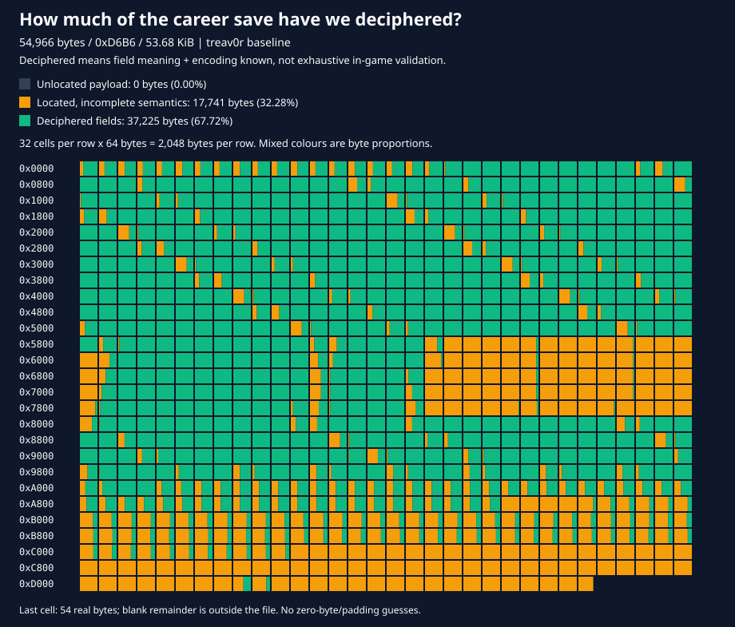

# NFSU2 Savegame Editor — Matavanary Edition

[ **🇹🇭 ภาษาไทย (README.md)** ] | [ **🇬🇧 English** ]

---

A browser-based career save editor for Need for Speed: Underground 2 (`SPEED2.EXE` saves, 54,966-byte `20CM` files). It also opens [nfsu2-web](https://github.com/th0mk/nfsu2-web) save-folder backup ZIPs, including their 10-slot `GARAGE.DAT` garages. Everything runs locally in the browser. Nothing is uploaded.

The live site is deployed to GitHub Pages at [https://matavanary.github.io/NFSU2-Savegame-Editor/](https://matavanary.github.io/NFSU2-Savegame-Editor/). See [doc.md](doc.md) for what we know about the save format.

## Savefile discovery map



The reference career save is **54,966 bytes (`0xD6B6`, 53.68 KiB)**. Read the grid left to right, top to bottom: each cell represents **64 bytes**, each row **2,048 bytes**. Mixed cells show the exact proportions of the three states, not a whole-cell approximation.

| Evidence state | Bytes | File coverage |
| --- | ---: | ---: |
| Deciphered: field meaning and encoding known | 37,225 | **67.72%** |
| Located inside a known structure, semantics incomplete | 17,741 | **32.28%** |
| Payload not assigned to a specific structure/field | 0 | **0.00%** |
| **Located in total (includes deciphered)** | **54,966** | **100.00%** |

This is a conservative, byte-weighted inventory of current repository evidence, **not a percentage of game features implemented or exhaustively verified in-game**. The header's two block boundaries locate the outer container only; they do not make all its payload "discovered."

| Located structure | Absolute range (end exclusive) | Size | Deciphered bytes |
| --- | --- | ---: | ---: |
| Header | `0x0000`–`0x001C` | 28 | 28 |
| Block A compatibility descriptor | `0x001C`–`0x0024` | 8 | 8 |
| Stock catalogue and active count | `0x0024`–`0x04A8` | 1,156 | 772 |
| 20 generic configurations | `0x04A8`–`0x5868` | 21,440 | 20,180 |
| Five native career car records | `0x5868`–`0x8022` | 10,170 | 5,115 |
| Garage-record count | `0x8022`–`0x8026` | 4 | 4 |
| Six special configurations | `0x8026`–`0x995E` | 6,456 | 6,054 |
| Special-configuration count | `0x995E`–`0x9962` | 4 | 4 |
| Eight stage records | `0x9962`–`0xA16A` | 2,056 | 1,800 |
| Career scalars and 384 event records | `0xA16A`–`0xAE9A` | 3,376 | 1,932 |
| 256 SMS inbox records and controls | `0xAE9A`–`0xC2A3` | 5,129 | 1,288 |
| Career tail | `0xC2A3`–`0xC447` | 420 | 0 |
| Profile copy spans | `0xC447`–`0xD225` | 3,550 | 0 |
| Driver-name field | `0xD225`–`0xD245` | 32 | 32 |
| Auxiliary tail object | `0xD245`–`0xD278` | 51 | 8 |
| Six identity-matched runtime-state records | `0xD278`–`0xD6B6` | 1,086 | 0 |

Each career garage record contributes **1,023 deciphered bytes**: its native slot handle (4), enumeration/type/initialization dwords (12), identity hash (4), 170 visual hashes (680), nine unique-performance flags (36), 68 installed-item positions (68), five dyno setups (205), lock/bought flags (2), first eight ownership bytes (8), and ordinary purchase-price accumulator (4). Visual hashes include derived/unused slots; deciphering their stored representation does not mean every slot is independently editable.

**First 4 KiB traced (2026-11-05):** `0x0000`–`0x0FFF` remains **100% structurally located**, with **3,534 bytes deciphered (86.28%)** and **562 bytes still semantically incomplete (13.72%)**. It contains the container, a compatibility descriptor, 48 stock catalogue records and the beginning of 20 generic saved car configurations—not the career garage slots. See [the field-by-field trace](technical.md#first-4-kib-trace-2026-11-05).

**Whole-file first pass:** internal native serializers now account for every byte through EOF, including all repeating configurations, stages, events, SMS messages and tail blocks. Original x86 collection/profile/tail instructions passed fixture or constrained synthetic routing checks; the career loader intentionally resets four transient dwords, and the SMS loader compacts unresolved definitions and recomputes counts. See [the boundary ledger, normalization rules and validation limits](technical.md#whole-file-first-pass-2026-11-05). Structural coverage is not complete semantic understanding.

**Important correction:** `0xA175` is the **uint32 current career-stage index**, not a garage count. The actual garage-record count is at `0x8022`. Car replacement now preserves the stage field; its old low-byte write has been removed.

The 420 category-unlock offsets are **sparse**, not a contiguous table. Eight overlap the mapped performance ownership bytes; the remaining 412 per car stay amber because individual-part semantics are not established. The ninth ownership byte also stays amber because its visual-purchase interpretation is unverified. Donor-copy blocks, record gaps and zero-filled bytes are not automatically counted as deciphered. The fixed event array has **384 entries**, of which 137 are active in the reference: each name hash (`+0`) and traced status byte (`+6`) is green, while three bytes per entry remain amber. Shop discovery at `+4` is now verified for shop hashes, but is not promoted across the whole mixed event array: non-shop meanings still need tracing. Status values are not universal completion/unlock flags.

Scope: the repository's `testfile/treav0r` career file, including empty car records; separate ZIP/GARAGE.DAT bytes are excluded. Evidence comes from [layout constants](src/model/layout.ts), [save validation](src/model/save-file.ts), [performance mappings](src/model/perf.ts), [dyno layouts](src/model/dyno.ts), [unlock ranges](src/data/unlock-table.ts), and the serializer/event traces in [technical.md](technical.md). Byte coverage counts overlapping interpretations only once.

Regenerate after updating the evidence ranges in [scripts/save-coverage.mjs](scripts/save-coverage.mjs):

```sh
npm run build
node scripts/save-coverage.mjs
```

The generator checks the reference file's structure and checksums, compatibility descriptor, stock count/index sequence, event capacity and first-4-KiB totals. It requires contiguous internal block boundaries through EOF, rejects invalid/duplicate evidence ranges, emits per-block totals, and verifies that the grid accounts for every byte exactly once.

## Features

- **Bilingual UI (Thai / English):** One-click toggle between 🇹🇭 Thai and 🇬🇧 English.
- **Quick Money Presets:** Add +50K, +100K, +500K, Max Money ($2,147,483,647) or reset to $0 instantly.
- **Drag & Drop Save File Upload:** Drop your `.20CM` save file or backup ZIP anywhere onto the page.
- **Local Snapshot / Backup Manager:** Automatically stores recent save history (up to 5 versions) in the browser with 1-click restore.
- **100% Offline PWA Ready:** Localized libraries with Service Worker caching; installable on desktop as an app.
- Edit driver name and money, with checksums recalculated on download.
- Career access (experimental): stage selector **0–6**, progression-safe shop discovery, and a separate **Complete career (100%)** action using local `GLOBALB.BUN`. Full completion intentionally changes real event/photo goals and stage results; does not fabricate money, cars or reward ownership. Completed race/photo markers disappear. Dealer-car/part gates are also reported.
- Open a raw career save or an nfsu2-web backup ZIP; the file type is detected from its contents.
- View each car slot's make and model, read from the car type hash.
- Replace or add a car in a slot. Tuning is kept.
- Edit mapped performance parts and separate unique-performance flags.
- Body, paint, four vinyl layers and their colours, decals, lighting, trunk audio, specialties and custom dials from your local game's part catalogue, filtered for the selected car.
- Dyno: simulate peak power and torque, 0–60, 0–100, quarter mile and top speed per setup (metric and imperial side by side), edit the ECU and turbo graphs and the gear ratios like the game's tuning screens, and auto-tune them (needs your game's `GLOBALB.BUN`).
- Remaining dyno menus: suspension/steering, front/rear aerodynamics, tires/brake bias and coupled nitrous duration/flow, with installed-part ranges and defaults.
- Swap slots (experimental) and unlock all slots.

## Development

Requirements: Node.js 24 or newer.

```
npm ci
npm run build    # compiles src/ to dist/ and copies static files
npm run dev      # watch mode (tsc -w)
npm test         # build, then run the test suite
npm run clean    # remove dist/
```

Each build stamps the header with the package version and a UTC build number (`YYYYMMDDhhmmss`).

The source layout is:

- `src/model/`: save parsing and editing logic, with no DOM access.
- `src/data/`: static tables (performance parts, unlock ranges, translations).
- `src/controller/`: the AngularJS controller, scope types, and file directives.
- `src/main.ts`: AngularJS bootstrap.
- `src/test/`: tests.

## Running locally

The editor fetches `car-donors.json`, so it must be served over HTTP rather than opened directly from disk. After `npm run build`, serve `dist/`:

```sh
cd dist
python -m http.server 8765
```

Or when running under Apache / XAMPP, open:
`http://localhost/ENOMBAN/NFSU2-Savegame-Editor/`

## Deployment

`.github/workflows/deploy.yml` runs the tests and builds on every push to `main`, then deploys `dist/` to GitHub Pages.

## Usage

1. Choose a career save (for example `treav0r`) or an nfsu2-web backup ZIP. Files are read in the browser and never uploaded. For a ZIP, choose the profile to edit.
2. Edit the driver name and money, then click **Apply profile**.
3. Filled car slots show their make and model, identified by the car type hash at slot offset `+0x014`. Hashes absent from the donor list show as unknown; locked/open slots hide the car name.
4. **Replace car** (or **Add car** for an empty slot) writes a donor car's slot blocks. Tuning is kept.
5. Open **Tuning**. Load your game's `GLOBAL\GLOBALB.BUN` once for **Body parts**, **Graphics**, **Specialties** and **Dyno**. Choose a category, edit its controls, then **Apply visual changes** or **Apply** the dyno draft. Discard leaves the saved values unchanged.
6. Click **Download edited save** or **Download edited ZIP**. Checksums are recalculated on download.

## Credits & Acknowledgements

This edition is maintained and customized by **Matavanary Studio**.
Special thanks and credit to the original creators and contributors:
- Original project by Christopher Hack: [hackch/NFSU2-Savegame-Editor](https://github.com/hackch/NFSU2-Savegame-Editor)
- Save backup format & research: [th0mk/nfsu2-web](https://github.com/th0mk/nfsu2-web)
- Car donors data: GabriLex (`nfsu2profilemaster`)
- Need for Speed: Underground 2 &copy; Electronic Arts
